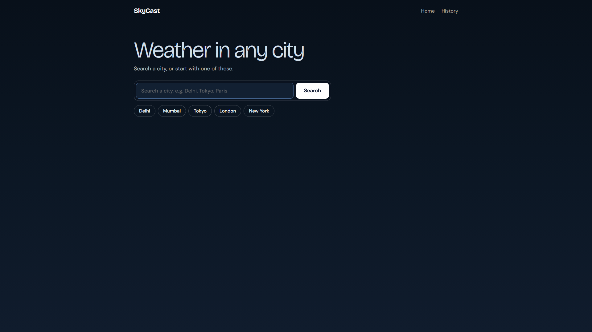
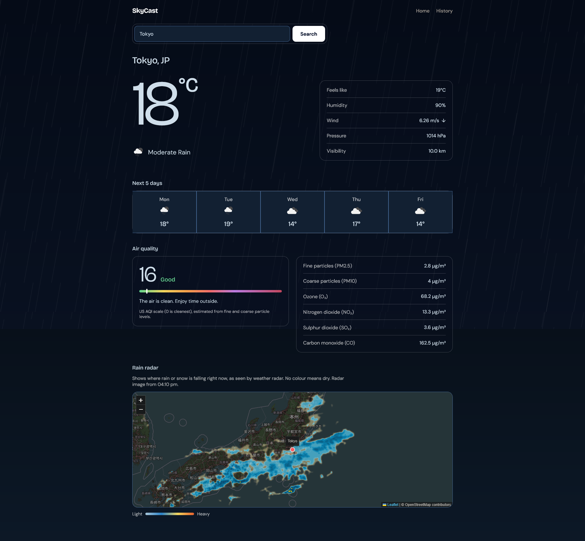
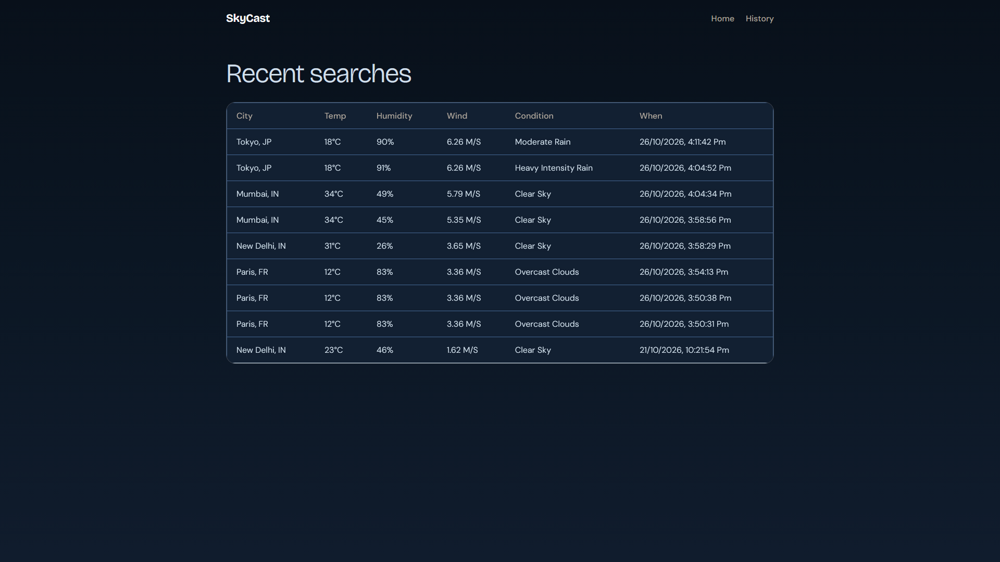

# SkyCast — Weather Web App

A weather website built with **Flask + MySQL + OpenWeatherMap + RainViewer radar**.
Search any city to see current conditions, a live
precipitation radar map, and every past search saved to a MySQL
database as searchable history.

---

## Live Demo
- [SkyCast Demo](https://skycast-weather-app-9ala.onrender.com/)

---

## Features

-  **City search** — type any city name; ambiguous names are resolved
  by coordinates (geocoding), not just text matching.
-  **Full current conditions** — temperature, feels-like, humidity,
  wind speed/direction, pressure, and visibility.
-  **Live precipitation radar** — an interactive Leaflet map with a
real-time radar overlay (via RainViewer, no API key needed).
-  **Weather history in MySQL** — every search is saved with a
  timestamp and viewable on a dedicated `/history` page.
-  **Real error handling** — bad city names, API downtime, timeouts,
  and database failures all return clear messages instead of crashing.
-  **Logging** — every request and error is logged to `logs/app.log`.

---

## Tech Stack

| Layer      | Choice                                             |
|------------|-----------------------------------------------------|
| Backend    | Python 3.10+, Flask                                |
| Database   | MySQL (via `mysql-connector-python`, with pooling) |
| Weather data | [OpenWeatherMap API](https://openweathermap.org/api) (free tier) |
| Radar      | [RainViewer public API](https://www.rainviewer.com/api.html) (no key needed) |
| Frontend   | HTML, vanilla CSS, vanilla JS, [Leaflet.js](https://leafletjs.com/) for the map |
| Testing    | `unittest` with mocked HTTP calls |

---

## Project Structure

```
weather-app/
├── app.py                      # Flask app: routes + error handlers
├── config.py                   # Loads settings from .env
├── requirements.txt
├── .env.example                # Template — copy to .env
├── database/
│   ├── schema.sql              # MySQL table definitions
│   └── db.py                   # Connection pool + all SQL queries
├── services/
│   ├── weather_service.py      # OpenWeatherMap API calls
│   └── radar_service.py        # RainViewer API calls
├── templates/
│   ├── base.html
│   ├── index.html              # Search + weather + radar page
│   └── history.html            # Past-search history page
├── static/
│   ├── css/style.css
│   └── js/main.js
├── tests/
│   └── test_weather_service.py # Example unit tests (mocked HTTP)
└── logs/
    └── app.log                 # Created automatically at runtime
```

---

## Setup

### 1. Clone and create a virtual environment

```bash
git clone <your-repo-url>
cd weather-app
python3 -m venv venv

# Windows:
venv\Scripts\activate
# macOS/Linux:
source venv/bin/activate

pip install -r requirements.txt
```

### 2. Get a free OpenWeatherMap API key

Sign up at https://openweathermap.org/api — the free tier is enough
for this project. New keys can take up to an hour to activate.

### 3. Install & start MySQL, then create the database

- **Windows:** install MySQL via the [MySQL Installer](https://dev.mysql.com/downloads/installer/) or `winget install Oracle.MySQL`.
- **Linux (Debian/Ubuntu):** `sudo apt install mysql-server && sudo systemctl start mysql`
- **macOS:** `brew install mysql && brew services start mysql`

Then load the schema:

```bash
mysql -u root -p < database/schema.sql
```

### 4. Configure environment variables

```bash
cp .env.example .env
```

Open `.env` and fill in your `OPENWEATHER_API_KEY` and your MySQL
username/password.

### 5. Run it

```bash
python app.py
```

Visit **http://localhost:5000** in your browser.

---

## API Endpoints

| Method | Route            | Description                                  |
|--------|------------------|-----------------------------------------------|
| GET    | `/`              | Home page (search + weather + radar)          |
| GET    | `/history`       | Past-search history page                      |
| GET    | `/api/weather?city=` | JSON: current weather + forecast; saves to DB |
| GET    | `/api/radar`     | JSON: live radar frame metadata               |
| GET    | `/api/history?limit=&city=` | JSON: past searches from MySQL       |

---

## Screenshots

### Home Page


### Search Results


### Search History

---

## Design decisions worth knowing about

- **Geocode-then-fetch, not name-based lookup** — city names alone are
  ambiguous (many "Springfield"s exist worldwide), so the app first
  resolves a name to exact coordinates, then fetches weather for that
  point. This is also what lets the radar map center precisely.
- **Two normalized MySQL tables**, not one flat table — `cities` is
  stored once per place; `weather_records` references it by foreign
  key. This avoids repeating the same city name/coordinates on every
  single search.
- **A service layer** (`services/`) sits between Flask and the outside
  world, so `app.py` never calls `requests.get()` directly. This keeps
  routes short and makes the API-calling code independently testable
  (see `tests/`).
- **Custom exception classes** (`CityNotFoundError`, `WeatherAPIError`,
  `DatabaseError`) let one set of Flask error handlers turn every kind
  of failure into a clear JSON message and the correct HTTP status
  code, instead of leaking raw tracebacks.

---

## Possible next steps

- Add a "favorite cities" table so users can save cities without
  re-searching them.
- Cache weather lookups for a few minutes to reduce API calls for
  popular cities.
- Add pagination to the history page instead of a fixed `limit`.
- Deploy behind Gunicorn + Nginx instead of Flask's built-in dev server.

---

## License

This project is provided as-is for learning purposes.
